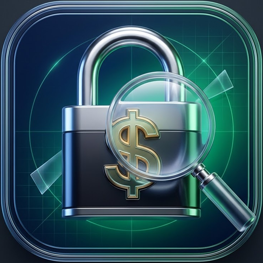

<div align="center">
  
  <h1>3MK F X G — Spending Tracker</h1>
  <p><strong>Personal Balance, Income, Monthly Limit & 1-Hour "Was It Worth It?" Spending Tracker</strong></p>
  <p>3 Synchronized Copies (<strong>Desktop</strong> • <strong>iPhone</strong> • <strong>iPad</strong>) Sharing 1 Permanent Database — No Login, No Password, 100% Yours.</p>
  <p>Created by <a href="https://github.com/3mkfxg"><strong>@3mkfxg</strong></a> • Repository: <a href="https://github.com/3mkfxg/spending-tracker"><code>3mkfxg/spending-tracker</code></a></p>
</div>

---

## 📖 Table of Contents
1. [What Is 3MK F X G Spending Tracker?](#-1-what-is-3mk-f-x-g-spending-tracker)
2. [Step 1: Download the Repository from GitHub](#-step-1-download-the-repository-from-github)
3. [Step 2: Launch the Desktop App & Shared Database on Your PC](#-step-2-launch-the-desktop-app--shared-database-on-your-pc)
4. [Step 3: Sideload the App onto Your iPhone & iPad (Complete Sideloadly Guide)](#-step-3-sideload-the-app-onto-your-iphone--ipad-complete-sideloadly-guide)
5. [Step 4: Trust the App & Enable Developer Mode on iOS / iPadOS](#-step-4-trust-the-app--enable-developer-mode-on-ios--ipados)
6. [Step 5: Connect Your iPhone, iPad & Desktop to the Same Database](#-step-5-connect-your-iphone-ipad--desktop-to-the-same-database)
7. [Step 6: How to Use Every Feature in the App](#-step-6-how-to-use-every-feature-in-the-app)
8. [Alternative Install: Instant Wi-Fi Home Screen App (No 7-Day Refresh)](#-alternative-install-instant-wi-fi-home-screen-app-no-7-day-refresh)
9. [Project Folder Structure](#-project-folder-structure)
10. [Troubleshooting & FAQ](#-troubleshooting--faq)

---

## ✨ 1. What Is 3MK F X G Spending Tracker?

**3MK F X G** is a complete personal finance, savings, income, and monthly spending tracker built with **3 dedicated editions** (**Desktop**, **iPhone**, and **iPad**) that all share a **single permanent database** (`database/1money-db.json`).

### Key Features
- **🏦 3 Live Balance Counters**:
  1. **Counter 1 — Total Balance**: Automatically equals `Card Balance + Cash Balance`.
  2. **Counter 2 — 💳 Card Only Balance**: Tracks only the money on your Card.
  3. **Counter 3 — 💵 Cash Only Balance**: Tracks only your physical Cash.
- **💸 Track Every Payment (Card or Cash + What + Where)**:
  - Every payment requires choosing **💳 Card** or **💵 Cash**, entering **For What?** (what you bought), and **Where?** (which store/place).
  - Automatically subtracts from your chosen counter (**Card** or **Cash**) and your **Total Balance**.
- **➕ Track Every Income (Card or Cash + Source)**:
  - Enter any income you receive, choose **💳 Card** or **💵 Cash**, and enter the **Source** (e.g., *Salary, Allowance, Freelance, Gift*).
  - Automatically adds directly to your **Card Only** or **Cash Only** counter and your **Total Balance**.
- **📊 Every-Month Spending Analysis**:
  - Automatically analyzes any month you select and spotlights how much you spent on:
    - **🍔 Food & Drinks** *(Food, coffee, restaurants, groceries, snacks, etc.)*
    - **🎬 Cinema & Entertainment** *(Cinema, movies, tickets, games, fun, etc.)*
    - **🚕 Taxi & Transport** *(Taxi, Uber, Careem, bus, metro, fuel, etc.)*
  - Includes a **Category Breakdown** with progress bars AND an **"Exact Things You Paid For This Month"** table showing how many times you bought each specific item and the exact total spent on it in that month.
- **🎯 Monthly Spending Limit + Automatic Reset on the 1st of Every Month**:
  - Set a monthly spending limit to see how much of your budget you have used.
  - **Automatically resets your monthly spending counter to `$0.00` on the 1st day of every month**, while permanently saving past months in **Monthly Reset Archives**.
- **💭 1-Hour *"Was It Worth It?"* Notification**:
  - **1 hour** after you record a payment, the app sends you a notification asking: **"Was it worth it?"**
  - Answer **👍 Yes, Worth It!** or **👎 No, Regret It** to track your smart vs. regretted purchases (also includes a **⚡ 10-Second Test Mode** so you can test notifications immediately).
- **📲 Clean Multi-Page iPad & iPhone Layouts + Keyboard-Safe Controls**:
  - The **iPad Edition** gives every single feature its own dedicated page (9 clean pages).
  - Includes one-tap **`⌨️⬇️ Done / Hide Keyboard`** buttons, auto-dismissing keyboards when tapping buttons, and top + bottom **`✅ Save`** buttons so the keyboard never blocks your screen.

---

## 📥 Step 1: Download the Repository from GitHub

You can download this project onto your computer in **2 ways**:

### Option A: Download as a ZIP File (Easiest — No Git Needed)
1. Open the GitHub repository page in your browser:
   👉 **[`https://github.com/3mkfxg/spending-tracker`](https://github.com/3mkfxg/spending-tracker)**
2. Click the green **`<> Code`** button near the top-right of the page.
3. Click **`Download ZIP`**.
4. Once downloaded, right-click the **`spending-tracker-main.zip`** file on your computer and click **`Extract All...`**.
5. Extract it to an easy-to-find folder (for example, on your **`Desktop`**).

### Option B: Clone Using Git (For Developers)
Open PowerShell, Command Prompt, or Terminal and run:
```bash
git clone https://github.com/3mkfxg/spending-tracker.git
cd spending-tracker
```

---

## 🖥️ Step 2: Launch the Desktop App & Shared Database on Your PC

To run the **Desktop Copy** and host your **Shared Database Server** so your PC, iPhone, and iPad stay synced:

### 2.1 — Install Node.js (One-Time Setup)
1. Go to **[https://nodejs.org](https://nodejs.org)** and download the **LTS (Long Term Support)** installer for Windows or Mac.
2. Run the installer and click **Next → Next → Finish**.

### 2.2 — Start the Desktop App (1 Click)
- **On Windows**:
  1. Open the extracted **`spending-tracker`** folder.
  2. Double-click **`Start-3MK-FXG-Desktop.bat`** *(or open `1-Desktop-Copy` and double-click `Start-Desktop-Copy.bat`)*.
  3. This automatically starts the **Shared Database Server** in the background (on port `3456`) and opens the **3MK F X G Desktop App** in its own standalone window!
- **Or Using Terminal (Windows / macOS / Linux)**:
  ```bash
  npm start
  ```
  Then open **`http://localhost:3456/desktop`** in your browser.

---

## 📱 Step 3: Sideload the App onto Your iPhone & iPad (Complete Sideloadly Guide)

This repository already includes pre-built, ready-to-sideload **`.ipa`** files for both **iPhone** and **iPad** — you do **not** need a Mac or Xcode!

| Device | `.ipa` File to Sideload | Location in Repository |
| :--- | :--- | :--- |
| **📱 Apple iPhone** | **`3MK-F-X-G-iPhone.ipa`** | Root folder `./3MK-F-X-G-iPhone.ipa` *(also in `2-iPhone-Copy/3MK-F-X-G-iPhone.ipa`)* |
| **📲 Apple iPad** | **`3MK-F-X-G-iPad.ipa`** | Root folder `./3MK-F-X-G-iPad.ipa` *(also in `3-iPad-Copy/3MK-F-X-G-iPad.ipa`)* |

---

### 3.1 — What You Need Before Sideloading (One-Time PC Setup)
1. **A USB Cable** to connect your iPhone or iPad to your computer.
2. **An Apple ID** (your normal free Apple ID works — no paid developer account is needed).
3. **Sideloadly Installed on Your Computer**:
   - Go to **[https://sideloadly.io](https://sideloadly.io)** and download **Sideloadly** (64-bit or 32-bit for Windows, or macOS).
   - **Important for Windows Users**: Sideloadly requires the classic web versions of **iTunes** and **iCloud** (not the Microsoft Store versions) so Windows can talk to your iPhone/iPad over USB. Direct download links for both are listed right on the [Sideloadly download page](https://sideloadly.io). Install them and restart your PC if you don't have them yet.

---

### 3.2 — Step-by-Step: Sideloading the `.ipa` with Sideloadly

1. **Plug Your iPhone or iPad into Your PC via USB**:
   - Unlock your iPhone/iPad screen.
   - If a popup appears on your iPhone/iPad asking **"Trust This Computer?"**, tap **Trust** and enter your phone passcode.
2. **Open Sideloadly on Your PC**:
   - Look at the **`iDevice`** field at the top-right of Sideloadly — your iPhone or iPad name should appear there automatically.
3. **Enter Your Apple ID**:
   - In the **`Apple account`** box inside Sideloadly, type your **Apple ID email address**.
4. **Load the `.ipa` File into Sideloadly**:
   - Drag and drop **`3MK-F-X-G-iPhone.ipa`** (if installing on iPhone) or **`3MK-F-X-G-iPad.ipa`** (if installing on iPad) directly onto the big **`IPA`** box on the left side of Sideloadly.
5. **Click the `Start` Button**:
   - Click **`Start`** at the bottom of Sideloadly.
   - If this is your first time using Sideloadly with this Apple ID, Sideloadly will ask for your **Apple ID password** and the **6-digit verification code** sent to your iPhone/iPad.
6. **Wait for `Done!`**:
   - Sideloadly will sign and install the app (`Signing...` → `Installing...` → `Done!`). This takes about 20–40 seconds.
   - Look at your iPhone or iPad Home Screen — the **3MK F X G** app with its custom icon is now installed!

---

## 🔓 Step 4: Trust the App & Enable Developer Mode on iOS / iPadOS

When you sideload any `.ipa` app using a free Apple ID for the first time, Apple requires you to **Trust** your own Apple ID certificate in Settings before the app will open. Follow these two quick steps on your iPhone or iPad:

### 4.1 — Trust Your Developer Certificate
1. On your iPhone or iPad, open the **Settings** ⚙️ app.
2. Tap **General** → scroll down and tap **VPN & Device Management** *(called **Profiles & Device Management** on older iOS versions)*.
3. Under the **Developer App** section, tap on your **Apple ID email**.
4. Tap the blue **`Trust "[Your Apple ID]"`** button.
5. Tap **`Trust`** in the confirmation popup.

### 4.2 — Turn On Developer Mode (Required on iOS 16 / iOS 17 / iOS 18+)
If your iPhone/iPad shows a popup saying *"Developer Mode Required"*:
1. Open **Settings** ⚙️ → tap **Privacy & Security**.
2. Scroll all the way to the bottom and tap **Developer Mode**.
3. Toggle **Developer Mode** to **ON**.
4. Tap **Restart** when prompted.
5. Once your iPhone/iPad finishes restarting, unlock your screen — a popup will appear. Tap **`Turn On`** and enter your device passcode.

### 4.3 — Open 3MK F X G!
1. Tap the **3MK F X G** icon on your Home Screen!
2. When the app asks **"3MK F X G Would Like to Send You Notifications"**, tap **Allow** so you receive the **1-Hour *"Was it worth it?"*** alerts after every payment.

> **💡 Tip on 7-Day Automatic Refresh**: Free Apple ID certificates last 7 days. As long as Sideloadly's daemon is running on your PC and Wi-Fi sync is enabled in iTunes, Sideloadly can automatically refresh the app over Wi-Fi so you never lose your data. Even if the app ever expires after 7 days, **just re-sideload the `.ipa` with Sideloadly without deleting the app** — all your balances and payments stay saved!

---

## 🔗 Step 5: Connect Your iPhone, iPad & Desktop to the Same Database

Your sideloaded **iPhone** and **iPad** apps work **100% offline** out of the box (saving everything on your device). If you also want your **iPhone**, **iPad**, and **Desktop PC** to share the **exact same live database** over your home Wi-Fi:

1. **Start the Desktop Server on Your PC**:
   - Double-click **`Start-3MK-FXG-Desktop.bat`** on your PC.
2. **Find Your PC's Local Wi-Fi URL**:
   - Look at the **🔗 Shared Database & 3-Device Sync Vault** card on the right side of the **Desktop App** (or look at the terminal window where the server started).
   - It will show your PC's Wi-Fi address, which looks like:
     `http://192.168.x.x:3456`
3. **Enter That Address in Your iPhone & iPad App (One Time)**:
   - On your **iPhone** (in the **🔄 Sync** tab) or **iPad** (on **Page 9: 🔄 Shared DB Sync**), find the **Connect DB** box.
   - Type your PC's address (for example, `http://192.168.1.50:3456`) and tap **`Connect DB`**.
   - The top status pill will turn green (**`🟢 Shared DB Live`**), and all 3 devices (**Desktop**, **iPhone**, and **iPad**) will now sync your balances, income, payments, and monthly analysis in real time!

> **✈️ Works Offline Everywhere**: When you leave home and are away from your PC's Wi-Fi, your iPhone and iPad automatically save every payment and income into their built-in offline vault (`🟡 Offline Vault Saved`). The moment you return to your home Wi-Fi, everything syncs back to your PC database automatically!

---

## 🎮 Step 6: How to Use Every Feature in the App

### 1. Setting Your Starting Card & Cash Balances
1. Go to the **🏦 Balances** view and tap **`✏️ Edit Balances`**.
2. Enter your current **💳 Card Only Balance** and **💵 Cash Only Balance**.
3. Your **🏦 Counter 1: Total Balance** automatically calculates `Card + Cash`.
4. Tap **`✅ Save Balances`**.

### 2. Setting Your Monthly Spending Limit & Currency
1. On the **Monthly Spending Limit** card (or **Page 4** on iPad), tap **`🎯 Set Limit`**.
2. Enter your monthly spending budget (e.g., `1000.00`) and your preferred currency symbol (`$`, `€`, `£`, `SAR`, `AED`, etc.).
3. Tap **`✅ Save Limit`**.
4. On the **1st day of every month**, your monthly spent counter automatically resets to `0.00` and saves the completed month in **🗂️ Monthly Reset Archives**.

### 3. Recording a Payment (Card or Cash)
1. Go to **💸 Enter Payment** (Tab 2 on iPhone, Page 2 on iPad, or Center Column on Desktop).
2. **Step 1**: Enter how much you spent (e.g., `15.00`).
3. **Step 2**: Tap **💳 Card** or **💵 Cash** *(mandatory — subtracts from that exact counter and Total Balance)*.
4. **Step 3 ("For what?")**: Type what you bought (or tap one of the quick chips like **`Food`**, **`Cinema`**, **`Taxi`**, **`Coffee`**).
5. **Step 4 ("Where?")**: Type where you spent it (e.g., *Mall, Restaurant, Uber, Cinema*).
6. **Step 5 (1-Hour Timer)**: Leave it on **⏱️ After 1 Hour (Default)** — or tap **⚡ After 10 Sec (Test Now)** if you want to see the *"Was it worth it?"* notification fire in 10 seconds!
7. Tap **`✅ Record Payment & Start 1-Hour Timer`** (or the **`✅ Save`** button at the top of the card).

### 4. Recording Income (Card or Cash)
1. Switch to **➕ Enter Income** (or **Page 3** on iPad).
2. Enter the income amount, tap **💳 Card** or **💵 Cash**, and enter **From what / Source?** (e.g., *Salary, Allowance, Gift, Freelance*).
3. Tap **`➕ Add Income to Balance`**. It immediately increases your chosen counter (**Card** or **Cash**) and your **Total Balance**.

### 5. Viewing Your Every-Month Spending Analysis
1. Open **📊 Monthly Analysis** (Tab 3 on iPhone, Page 5 on iPad, or Left Column on Desktop).
2. Use the **Month Dropdown** at the top-right of the card to pick the current month or any past month.
3. View your 3 automatic spotlight totals:
   - **🍔 Food & Drinks**
   - **🎬 Cinema & Fun**
   - **🚕 Taxi & Rides**
4. Scroll down to **"Exact Things You Paid For This Month"** to see every single item name you entered, how many times you paid for it (`1x`, `2x`, `5x`), how much was paid by Card vs. Cash, and the total spent on that item in the month.

### 6. Answering the 1-Hour *"Was It Worth It?"* Notification
- **1 hour** after every payment, you'll get a notification asking: **"💭 Was it worth it?"**
- Tap **👍 Yes, Worth It!** or **👎 No, Regret It** in the popup (or in the **💭 Worth It?** tab/page) to track your satisfaction score.

---

## 🌐 Alternative Install: Instant Wi-Fi Home Screen App (No 7-Day Refresh)

If you don't want to use a USB cable or Sideloadly, you can also install **3MK F X G** directly from Safari over your home Wi-Fi in 10 seconds (and it **never expires** after 7 days):

1. Start **`Start-3MK-FXG-Desktop.bat`** on your PC.
2. Connect your iPhone or iPad to the same Wi-Fi network as your PC.
3. Open **Safari** on your iPhone and go to:
   `http://YOUR-PC-IP:3456/iphone`
   *(Or on your iPad, go to `http://YOUR-PC-IP:3456/ipad`)*
4. Tap the **Share** button (**⬆️** at the bottom of Safari on iPhone, or top-right on iPad).
5. Scroll down and tap **`Add to Home Screen`** → tap **`Add`**.
6. The **3MK F X G** app with your custom icon now lives on your Home Screen, opens full-screen without Safari bars, works offline, and syncs live with your PC!

---

## 📂 Project Folder Structure

```text
spending-tracker/
├── 3MK-F-X-G-iPhone.ipa          # Ready-to-sideload iPhone .ipa package
├── 3MK-F-X-G-iPad.ipa            # Ready-to-sideload iPad .ipa package
├── Start-3MK-FXG-Desktop.bat     # 1-Click Windows Launcher (Desktop App + Database Server)
├── package.json                  # Node.js scripts & project metadata
├── README.md                     # This complete step-by-step guide
├── 1-Desktop-Copy/               # Copy 1: Desktop Command Center Edition
│   ├── Start-Desktop-Copy.bat
│   └── www/
├── 2-iPhone-Copy/                # Copy 2: iPhone Edition + Capacitor iOS Config + .ipa
│   ├── 3MK-F-X-G-iPhone.ipa
│   ├── capacitor.config.json
│   └── www/
├── 3-iPad-Copy/                  # Copy 3: iPad 9-Page Edition + Capacitor iPadOS Config + .ipa
│   ├── 3MK-F-X-G-iPad.ipa
│   ├── capacitor.config.json
│   └── www/
├── database/                     # Permanent Shared Database Storage
│   └── 1money-db.json            # Atomic JSON database (starts at $0.00)
├── server/                       # Zero-dependency Node.js Shared Database & SSE Sync Server
│   ├── server.js
│   └── launch-desktop.js
├── shared/                       # Shared Core Engine, UI Controller, Styles & Custom App Icons
│   ├── 1money-core.js
│   ├── 1money-ui.js
│   ├── 1money-styles.css
│   ├── icon.png
│   └── icons/
└── scripts/                      # Build, Sync & Automated Test Scripts
    ├── sync-editions.js          # Syncs shared code into all 3 copies
    ├── build-ipa-files.py        # Rebuilds 3MK-F-X-G-iPhone.ipa & 3MK-F-X-G-iPad.ipa
    └── test-suite.js             # End-to-end automated verification suite
```

---

## 🛠️ Troubleshooting & FAQ

### Q1: Sideloadly doesn't detect my iPhone or iPad when plugged in via USB.
- Make sure you installed the **web versions** of **iTunes** and **iCloud** from Apple (linked on [sideloadly.io](https://sideloadly.io)), **not** the Microsoft Store versions.
- Unlock your iPhone/iPad screen while plugged in and tap **"Trust This Computer"**.

### Q2: When I tap the 3MK F X G icon on my iPhone/iPad, it says *"Untrusted Developer"*.
- Go to **Settings → General → VPN & Device Management**, tap your Apple ID under **Developer App**, and tap **Trust**. (See [Step 4](#-step-4-trust-the-app--enable-developer-mode-on-ios--ipados)).

### Q3: How do I hide the keyboard on iPhone or iPad?
- Tap the floating **`⌨️⬇️ Done / Hide Keyboard`** pill at the top-right of the screen, tap **`Done`** on the iOS keyboard, or simply tap **💳 Card**, **💵 Cash**, or any quick-chip — the keyboard automatically drops out of the way. You can also tap the **`✅ Save`** button right at the top of the form card!

### Q4: How do I back up my database or move it to another computer?
- Open the **🔄 Sync** page/card and click **`⬇️ Export Full DB Backup`** to download a complete `.json` snapshot of all your balances, income, payments, and monthly archives. You can restore it anytime using **`⬆️ Restore DB Backup`**.
